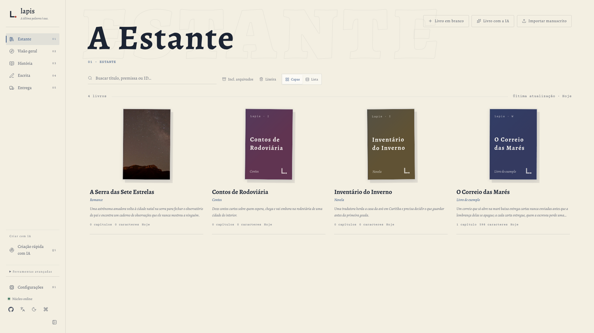
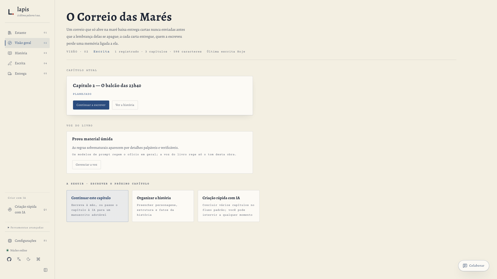
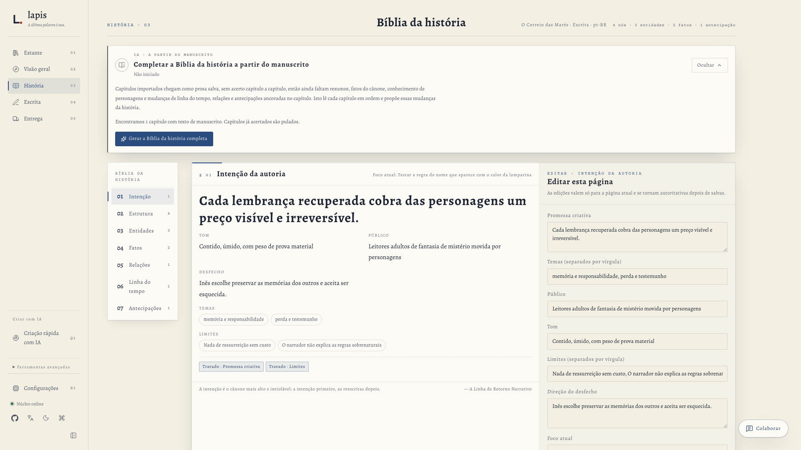
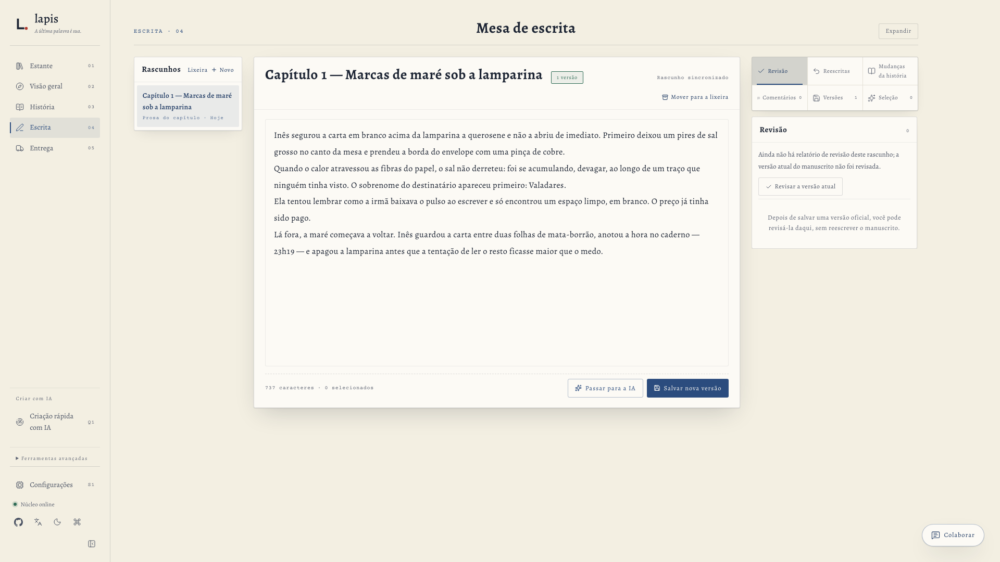
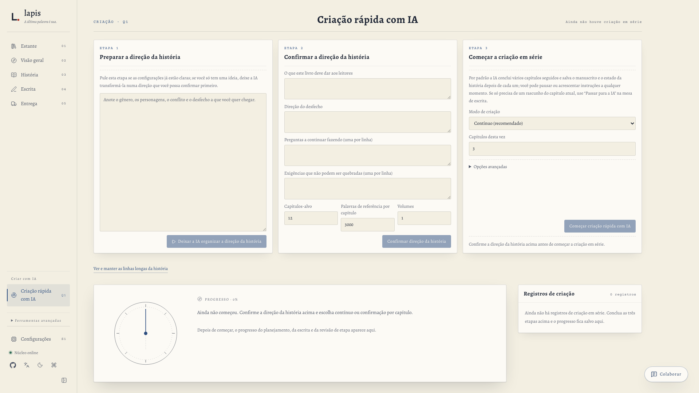
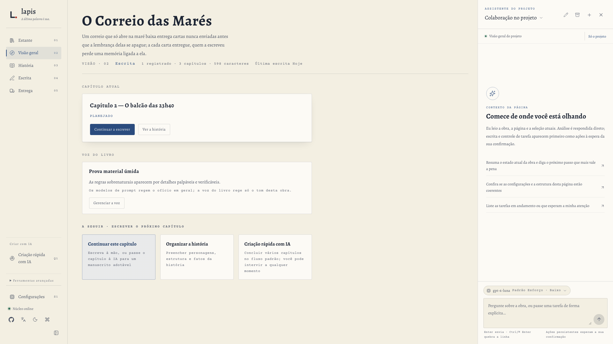
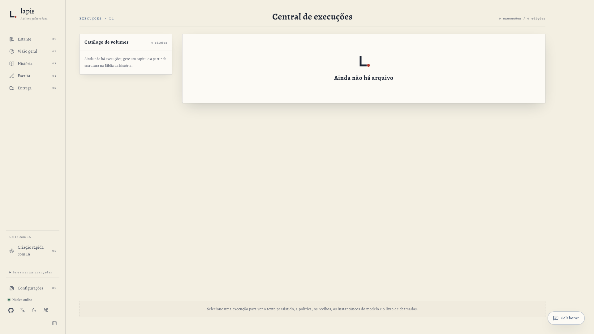
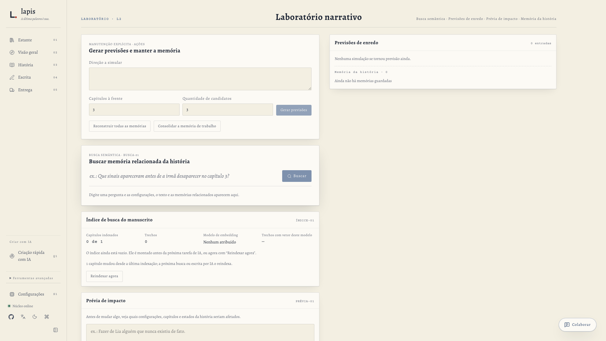
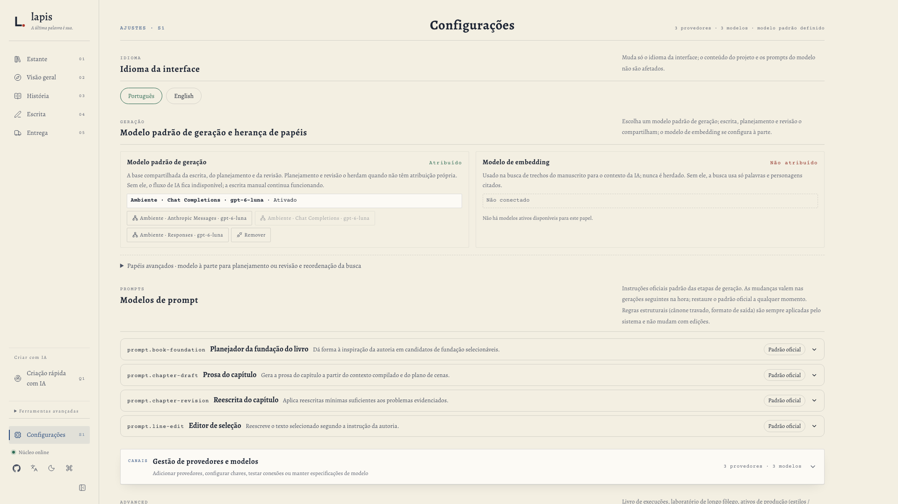
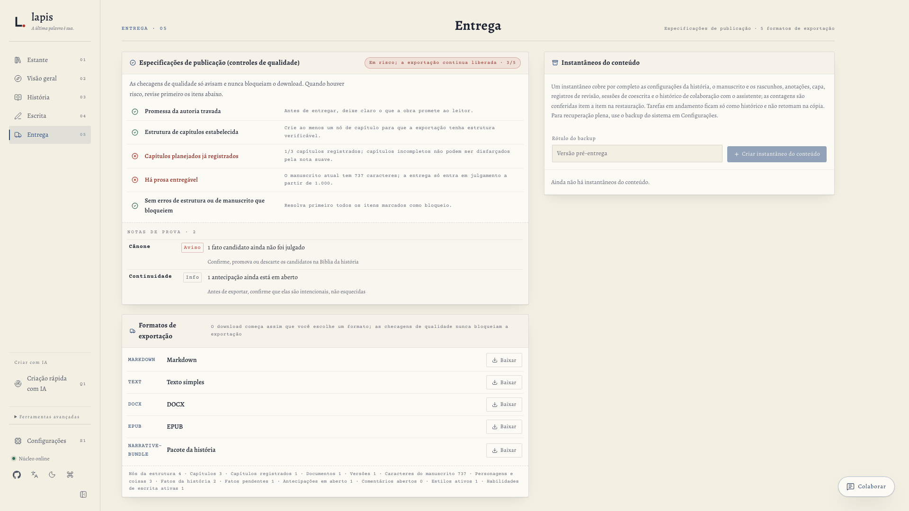

[Português](user-guide.md)

# User Guide

This guide introduces Lapis in the order of the writing process. You do not have to read it end to end: start from the Shelf, and read each page as you reach it. Button names in the interface appear in quotes throughout.

## Three things to know first

### Writing works without a model

A model is only needed for AI generation, review, story organization, and semantic search. Without one, you can still:

- create, import, and manage works;
- organize story intent, outline, characters, facts, timeline, and foreshadowing;
- write prose by hand at the writing desk, and save versions and comments;
- export works, create content snapshots, and download full-library backups.

### AI proposes, the author decides

AI-generated prose, edit suggestions, and story-setting changes always appear as candidates first. A candidate never overwrites the current prose, nor does it change story settings directly. You can adopt, reject, or keep each item; only adopted content becomes the official version.

### Data depends on how you run it

The browser local kernel keeps a database scoped to the current browser and site; the Windows, macOS, and Linux launchers and source mode use the local Server; Docker uses its own data volume. They do not synchronize automatically just because they share the same browser or project name. See [Data, privacy, and backup](data-and-backup.en.md) for migration and recovery.

## Getting to know the interface

The left navigation starts with the daily mainline: Shelf, Overview, Story, Writing, and Delivery. "AI Quick Create" sits alone in the "AI Create" group. Runs and Narrative Lab sit in the "Advanced tools" group, which starts collapsed: click "Advanced tools" to open it. Settings sits at the bottom of the navigation, above the kernel status. Once you enter a work, the left entries always point at the current work — no need to go back to the Shelf to pick it again.

Common global entries:

- Click the collapse button in the lower-left corner to leave more horizontal room for prose; navigation collapses automatically on narrow screens.
- Click the sun or moon icon to switch between light and dark; click it again to follow the system theme.
- Press `Ctrl+K` (`Command+K` on macOS) to open the command palette and jump to a workspace by name.
- Inside a work, press `Ctrl+J` (`Command+J` on macOS) to open or close the project Co-work sidebar.

"Kernel online" in the lower-left corner means the current data driver can respond to requests; it does not guarantee that a model provider is usable. Model connections are tested separately with "Probe" on each model card in "Settings".

The interface is available in Brazilian Portuguese, its primary language, and in English; a browser set to English opens in English. Switch it under "Interface language" in "Settings" or with the language button at the bottom of the navigation. The interface language does not change a work's writing language, which decides the language of AI prose and replies. Chinese is no longer offered: works whose writing language was Chinese in earlier versions now use Portuguese, and their text is not translated. The quoted names in this guide follow the English UI.

## Shelf: manage works

The Shelf is the entry point for all works. Each book shows its cover, title, subtitle, premise, chapter count, character count, and last-updated time.

The search box matches titles, premises, and IDs. The toolbar switches between the "Covers" and "List" views; "Incl. archived" only decides whether archived works are shown — it does not change any work's state.

### Create a work

On an empty Shelf, Lapis asks whether you have an idea or a manuscript: "Just an idea" opens the AI-guided book, "I already have a manuscript" opens the import, and "Create a book" opens a blank book.

Click "Blank book", fill in the title, choose the writing language and the form (short story, novella, or novel), then click "Create and shelve"; the work opens on its overview. The premise is optional and can be filled in later with "Edit book & cover" on the Shelf.

If you only have an idea, click "AI-guided book", write the premise and any ideas — genre, characters, directions — and click "Create and generate candidates". The work opens right away while the AI organizes your idea into direction candidates; the overview then points you to "Confirm the story direction". This entry requires an assigned default generation model; without one, the work is not created.

### Import an existing manuscript

Click "Import manuscript" and choose Markdown, plain text, DOCX, HTML, EPUB, or a Lapis project bundle (`.json`). The file is split into candidates right away, without a model, and nothing is written yet:

1. In the review dialog, check each candidate's type and title, and deselect items you do not need.
2. Click the button that shelves the selected items, or "Not now" to close the dialog without importing.
3. To import into an existing work, or to have the AI analyze a manuscript into characters, relations, timeline, style, and similar candidates, use "Import manager" in Settings: upload the file, click "AI analyze", review the candidates, then apply the selected ones or click "Discard batch". "View analysis run" opens the analysis in the Run Center.

A project bundle suits migrating a work already organized in Lapis; Markdown, plain text, DOCX, HTML, and EPUB suit importing prose or older drafts. Imports never carry model keys.

Prose is split into chapters at recognized headings:

- Markdown `#` to `###` headings, Chinese lines starting with `第N章` (or `节`, `卷`, `部`, or `回` in place of `章`, with N in Chinese numerals or digits and no spaces), and lines starting with `Chapter` plus digits; these two line forms have no length limit.
- Portuguese, Spanish, or English headings on a line of their own, up to 80 characters: `Capítulo`, `Chapter`, `Parte`, `Part`, `Livro`, `Libro`, or `Book` followed by a number (digits, optionally with an ordinal mark as in `1º`, `1ª`, or `1.º`; Roman numerals such as `II`; or spelled-out numbers such as `Um`, `Três`, `One`, `Twenty-One`); `Prólogo`, `Prologue`, `Epílogo`, `Epilogue`, `Interlúdio`, and `Interlude` may appear without a number. A title may follow the number after `:`, `.`, `–`, `—`, a `-` followed by a space, or a space, for example `CAPÍTULO II — O Retorno`, `Capítulo 1- A Chegada`, or `Capítulo 1. A Chegada`. The 80-character limit applies only to these keyword headings. A line stays prose when its title part starts with a lowercase letter, as in `Livro 1: leia antes de dormir.`, or when the title part follows `.` or a plain space, has three or more words, and ends in a single period, as in `Capítulo 3. Era a última página.`. Titles ending in `?`, `!`, `…`, or `...`, and titles after `:`, `–`, `—`, or `-`, stay headings, for example `Capítulo 5: Quem Matou Laura?` or `Capítulo 2 — O Fim do Mundo.`. A line also stays prose when the number runs into a hyphenated word, as in `Parte segunda-feira para Lisboa.`
- DOCX paragraphs using the Title or Heading 1–3 styles (including the same built-in styles in localized Word, such as Portuguese `Título 1`) or outline levels 1–3; `h1` to `h3` in HTML and EPUB. In HTML and EPUB, a heading that holds only an image takes the image's alt text as its title, or `§` when there is none, and heading markup that is never closed, or runs past 2000 characters, is read as ordinary text.

A heading that holds only a keyword and a number, such as `Capítulo 1` or `Chapter 1`, and is directly followed by a title heading with no text in between (Heading 1 + Heading 2 in Word, `h1` + `h2` in EPUB) becomes one chapter titled `Capítulo 1 — A Chegada`. This does not apply when the second heading is itself a chapter heading (`Parte II` followed by `Capítulo 1`), or to Chinese headings.

Text before the first heading (title page, epigraph, and similar) becomes its own section, named `卷首` in Chinese and other CJK manuscripts and after the work otherwise. A section whose only content is a page number (a table of contents at the start of the book) is dropped only under Portuguese, Spanish, and English keyword headings written as plain lines, such as `Capítulo 1 — A Chegada` or `Chapter One — Arrival`. Lines starting with `Chapter` plus digits (`Chapter 1 — Arrival`) and Chinese headings keep the previous behavior, and Markdown, DOCX, HTML, and EPUB headings are not filtered either: a table of contents under them still imports as short page-number sections, which you can deselect before applying. A line holding only `#`, `# # #`, `***`, `* * *`, or `⁂` is a scene break and stays in the text in every format, even when it uses a heading style or heading markup. When no heading is recognized, the whole text is imported as one manuscript.

AI analysis ("AI analyze" in the Import manager) is asked to write its candidates in the manuscript's own language. For Portuguese, Spanish, English, and Chinese manuscripts, the request also states the language detected from common words or the writing system. Both are best effort, so check the candidates before applying them. The labels Lapis adds itself, such as the author-intent candidate title and the headings of imported notes, follow the project language. The statistical style candidate, computed without AI, is written in Chinese for CJK manuscripts, in Portuguese for manuscripts detected as Portuguese, and in English for all others, including Spanish; the AI style candidate follows the manuscript language.

### Complete the Story Bible from the manuscript

Imported chapters arrive as saved prose, but they have not been settled chapter by chapter, so chapter summaries, canon facts, character knowledge, and chapter-anchored timeline, relation, and foreshadow changes are still missing. "Complete Story Bible from manuscript" settles every chapter in reading order through the same story-change pipeline used when you save a chapter by hand. It uses the writing model assigned in Settings and refuses to start rather than skipping chapters when no model is available. Every chapter incurs model cost: at least one model call, automatic retries when a response fails or is invalid (up to 5 attempts, and a malformed reply can add a repair call), plus one embedding call per chapter when an embedding model is assigned. There is no spending cap, so use "Pause" or "Cancel completion" whenever you want to stop; the panel shows the model calls and tokens used so far, and an estimated cost once model prices are configured in `NARRATIVE_MODEL_PRICING_JSON`.

- Where to start: after shelving an import that contains manuscript text, the Shelf import dialog offers "Generate Story Bible with AI"; in Settings → "Import manager", the same link appears next to the "Import applied." message. Both open the Story Bible workspace with the "Complete Story Bible from manuscript" panel expanded at the top. You can also open that panel there at any time with "Show", then click "Generate full Story Bible".
- The start dialog asks how story changes are adopted, shows how many chapters with manuscript text will be processed, and reminds you of the model cost. Click "Generate" to begin.
- "Review each chapter" pauses after every chapter that produced changes and shows them right in the panel. Click "Apply & continue" or "Reject & continue"; the next chapter is settled only after that decision, because later chapters build on the canon the earlier ones established. The same change set also appears in Studio's "Story changes" panel. Chapters with no story changes continue automatically.
- "Generate everything automatically (recommended)", the default, adopts each chapter's changes as soon as they are ready and otherwise keeps going through the whole book unattended. When a change conflicts with current canon (it targets a locked, missing, or since-changed record), it stops and lists the conflicts. Choose "Force apply & continue" (only when the conflict can be overwritten), "Apply & continue" after fixing the record, "Reject & continue", or "Skip chapter". It also stops before a chapter would withdraw or replace a fact, change or end a relation, anchor a timeline event to the chapter, or develop or resolve a foreshadow that neither this completion nor the import created, such as anything you entered yourself, and before it would reopen a resolved or abandoned foreshadow; the panel lists those records so you can apply or reject the chapter, and the completion then continues. Foreshadows the import created record where they came from, so developing or resolving them does not stop; foreshadows from an import applied before this update have no recorded origin and count as yours. New facts, events, relations, and foreshadows are added without stopping.
- While it runs, the panel shows how many chapters are done, the chapter being read, and a status for every chapter (Waiting, Reading, Needs review, Applied, Rejected, No changes, Failed, Skipped, Already settled). Use "Pause", "Resume", or "Cancel completion" at any time; pausing waits for the current chapter to finish, except that a settlement you started from Studio and the completion is reusing keeps running. If a chapter's settlement fails, use "Retry chapter" or "Skip chapter", and "View run" opens its run in the Run Center. Progress is saved, so the job continues where it stopped after a restart. If it stops on an unexpected error, the panel explains it and "Resume" tries again from the same chapter. Cancelling keeps already adopted changes; changes still awaiting a decision stay in the "Story changes" panel, and a settlement you started from Studio keeps running there. Skipping a chapter that awaits review does not decide it either: its change set stays in the "Story changes" panel.
- If you edit a chapter while the completion still has to read it, the completion reads the new text once instead of starting a separate settlement; the chapter's status notes the edit, and a change set already produced for the earlier text stays undecided in the "Story changes" panel. If you cancel before it gets there, the edited chapter is settled from Studio as usual. A settlement Studio already made for exactly the current text is used instead of reading it again.
- Chapters whose current text was already settled, with the result applied or with no story changes, are skipped; chapters whose changes were rejected are read again. Relations, timeline events, and foreshadows extracted during import are referenced and updated rather than created again: when a chapter shows a timeline event the import extracted and no chapter holds yet, that event is anchored to the chapter (shown as "Timeline · anchor" in the story changes, keeping its title, description, participants, causes, and visibility) instead of being added a second time. Each chapter is offered the imported events whose source evidence lies in that chapter, plus a limited number that could not be placed in any chapter, so events the prose only mentions early on do not crowd out later chapters. When the pass finishes it tells you how many imported timeline events are still not anchored to a chapter; they stay in the Timeline section. Only this pass anchors existing events; ordinary chapter settlements always create new ones. Chapter summaries and story changes are requested in the chapter's own language (a Portuguese manuscript gets Portuguese summaries, for example); this is best effort.
- When it finishes, the panel summarizes how many chapters were applied, rejected, had no changes, were skipped, or failed. Broader sections such as author intent, the overall outline, and character profiles are not written from individual chapters: the panel's suggestion buttons for "Intent", "Outline", and "Entities" jump to that section's AI candidate panel. "Run again" processes chapters added, changed, or rejected since.
- One click for the whole Story Bible: the panel's "Generate full Story Bible" button reads every chapter in order with "Generate everything automatically (recommended)" selected by default, so you do not click per chapter. With "Then generate Intent, Entities and Outline suggestions with AI (you review them in each tab)" checked (the default), the panel starts those three sections' AI suggestions as soon as the last chapter is done. If the panel was closed at that moment, it starts them the next time it opens on this computer, and "Generate Intent, Entities & Outline with AI" starts them by hand at any time.
- To redo one chapter, open the finished chapter list and click "Re-read" next to it. The AI reads that chapter again against the current Story Bible, adds what is missing, and corrects what is wrong without duplicating existing records; "Review the changes before applying them" is checked by default. To redo a section such as Entities, use that tab's AI panel with your own instruction.
- A project whose prose was imported as one single manuscript has no chapters to settle. The panel says so; re-import the file with chapter headings (for example "Chapter 1" or a Markdown "# Chapter title") so each chapter becomes its own document.

### Covers, duplication, and archive

From a work's more-actions menu, "Edit book & cover" edits the title, subtitle, premise, writing language, and cover. Covers support JPG, PNG, and WebP, and can be adjusted in a 3:4 portrait frame after upload.

"Copy" creates an independent work, good for experimental versions or handing to a collaborator. "Archive" hides a work from the default Shelf without deleting content; turn on "Incl. archived" to see it again.

### Recycle bin

Only an archived work can go to the recycle bin: "Move to recycle bin" asks you to type the title, then keeps the work for 30 days. Works in the recycle bin can be restored and come back archived; "Delete permanently" cannot be undone, and after that only a backup made earlier still holds the work. Confirm you have a readable backup before deleting.

## Project overview: know what to do next

After entering a work, you land on its "Overview", headed by the book's title. It concentrates:

- committed chapters, total characters, and the most recent writing time;
- the AI task currently running;
- pending items such as review issues, revision proposals, and story changes;
- next-step entries such as "Continue the current task", "Organize the story", and "AI quick creation".

You can leave the page while a task keeps running in the background. When you return, re-enter the original processing point from the overview or the task card ("Return to the task") — do not submit the same piece of work twice.

## Story: maintain story material

The "Story" page is also called the "Story Bible". It keeps material that affects later chapters in seven sections — "Intent", "Outline", "Entities", "Facts", "Relations", "Timeline", and "Foreshadows" — which you can switch quickly with the section tabs on the left.

### Author intent

Record the core reading experience this book promises, plus themes, audience, tone, ending direction, current focus, and boundaries it will not write. It is an important reference for AI planning and review, and your own basis for judging whether a candidate draft has drifted off course.

### Outline

Build the hierarchy of volumes, chapters, and scenes, with titles, summaries, and chapter goals. The tab has four views: "Outline and editing", "Story board", "Long story lines", and "Chapter state". Chapter prose can bind to an outline node; nodes already bound or archived do not reappear in the new-chapter list.

The outline is the writing plan, not the prose. Editing the outline does not automatically rewrite chapters that are already saved.

### Story lines and progress proposals

Use "Story → Outline → Long story lines" to maintain stage goals, progress, open promises, and future direction. Continuous-writing stage reviews produce progress proposals supported by manuscript summaries, with before/after values, the evidence summaries used at review time, and links back to chapters.

Only individual acceptance updates a story line; rejection preserves the decision without changing the record. Outdated proposals cannot overwrite changed records, and retries do not apply a change twice. The next planning window considers author decisions; future direction remains a plan. Missing or outdated manuscript summaries are never replaced by outline summaries as evidence.

### Inspect and maintain knowledge by chapter

Under "Story → Outline → Chapter state", select a chapter and perspective to inspect registrations through the end of that chapter, including its scenes. A changed fact does not imply a character has learned it. Beliefs, suspicions and false beliefs appear separately; no registration does not imply ignorance.

Open "Register and correct knowledge" for author maintenance. This includes records and revision history for the whole book, regardless of the perspective filter. Select the reader or a character, an existing fact or event, a belief state, and a committed chapter or scene. Backdated registrations retain later changes in knowledge.

Use "Register knowledge change" when a belief changes later in the story. Use "Correct registration" to fix an incorrect belief state or evidence node, with a reason. If the knower or claim is wrong, use "Withdraw registration" and register it again. Original entries and reasons remain in history. Withdrawal may reveal an earlier valid entry; it does not represent forgetting in the story.

If relevant records or references change before saving, your input is preserved with a conflict message. Copy what you want to keep, then choose "Discard changes and reload", review and submit again. Saved records inform inspection and future generation without rewriting existing prose.

### Entities, canon facts, and relations

- "Entities" holds people, places, organizations, items, and similar objects.
- "Canon facts" holds confirmed content such as character states, abilities, and setting limits.
- "Relations" records how relationships between people or entities change, and when.

You can edit these by hand in "Edit this page" or generate AI candidates in the corresponding section. The candidate panel shows an itemized diff; changing locked content asks for an explicit "Confirm locked-content change", so an ordinary candidate never overwrites it silently.

### Timeline and foreshadows

The timeline records events in the story world, with times and notes. Foreshadows track clues that are planned, planted, developing, resolved, or abandoned. An unresolved foreshadow is not automatically an error; its state changes only when you decide.

### Story candidates

In "Candidate changes", write down what you want to add or adjust — for example, "make the character's motivation more concrete, but do not change the locked ending". After "Generate candidate changes", review the diff item by item, then choose "Adopt this item" or "Reject". Nothing is written into the story material until adoption.

## Writing: from draft to official version

### Create a manuscript

On the "Writing" page, click "New" and choose the "Type":

- "Chapter manuscript": bound to a chapter of the outline;
- "Scene manuscript": bound to a scene of the outline; it can use the selection's AI editing, but "Hand to AI" is offered only for chapter manuscripts;
- "Outline draft", "Story synopsis", "Writing notes", and "Style sample": supporting material.

Chapter and scene manuscripts must be bound to an outline node; nodes already bound to a manuscript or archived are not offered again. If no matching outline exists, go back to "Story" and create the chapter or scene first.

### Write by hand and save versions

The prose editor is a rich-text editor that stores the text as Markdown. Type or paste text directly; the draft is synced as you write. Click "Save new version" when done. A saved version keeps the current prose and its point in time; you can later review it in the "Versions" panel and restore a historical version.

Restoring never rewrites old versions: "Restore as new version" adds the selected content as a new version, which becomes the current one.

### Manuscript recycle bin

"Move to recycle bin" at the top of the writing desk, next to the manuscript title, hides the current manuscript while keeping its prose, versions, comments, and review records. Manuscripts in the recycle bin take no part in new writing, review, or export tasks; to keep using one, open "Recycle bin" at the top of the draft list and click "Restore to drafts".

The manuscript recycle bin and the Shelf recycle bin are not the same level. The former handles manuscripts within one work and keeps them until you restore them, with no time limit; the latter handles whole works. Restoring a manuscript does not change the work's archive state.

### Selections, comments, and local edits

Select text in the prose first, then open the "Selection" tool:

- Record issues worth revisiting in "Comment". If the text has changes not yet saved as a version, the button reads "Save version and comment" and saves a version first, so the comment stays anchored to it.
- Describe the goal in "AI edit instruction" — for example, "reduce repetitive action description while keeping the tension" — and click "Generate edit proposal". The proposal appears below, under "Selection edits", with the original struck through and the replacement inserted.
- "Accept" applies the proposal as a new version, and "Reject" discards it; to try another instruction, generate a new proposal. A proposal never replaces the prose without your decision.

### Hand a chapter to AI

With a chapter manuscript open, click "Hand to AI". The AI generates a chapter candidate from the current story material and outline, then runs automatic checks and a review. The task panel opens at the top of the writing desk with the "Chapter plan", the "Candidate manuscript", and "This review".

"Adopt as manuscript version" creates an official prose version; the chapter's story changes then wait for you in the "Story changes" panel. "Ask for another pass" sends the AI a revision instruction, and "Discard candidate" drops the candidate. If generation fails, fix the model or network first, then click "Retry this chapter". If generation is interrupted, the part already generated can be recovered from "View task details" in the Run Center.

### Review and revisions

The "Review" panel shows the verdict for the current version, the score breakdown, and the issues awaiting a ruling; on a chapter manuscript, "Review current version" or "Review again" asks for a new review. Issues are usually categorized as continuity, character, pacing, prose, chapter goal, and the like.

Every issue carries evidence excerpts and a suggested action. You can "Accept" or "Reject" it, mark it as "False positive", or "Intentionally keep" it. Full-text revisions the AI proposes appear in the "Revisions" tab ("Revision proposals"): "Apply as new version" makes one the current version, and "Reject" discards it.

Review is an auxiliary check, not a publication license. Whether a passage stays is always the author's decision.

### Story changes

After a chapter version is saved or an AI candidate adopted, the system organizes the character states, facts, relations, timeline events, and foreshadows this chapter may have changed. Changes appear in the "Story changes" panel and are written into the story material only after "Adopt these changes"; "Not now" declines them.

If a change conflicts with the current canon — for example, a locked record — the panel lists the conflicts instead of adopting. When they can be overwritten, "Force adopt" appears; otherwise decline the set and fix the source in the manuscript. Resolve the conflict first, then continue with later tasks.

Co-creation is not part of v1, and the writing desk no longer links to it.

## AI quick creation: produce multiple chapters in one run

"AI quick creation" fits when the direction is already clear and you want several chapters to move forward at once. It shares the same chapter-production pipeline as "Hand to AI", but at a larger scope.

### Three steps

1. **Prepare the story direction** (optional): write your idea and click "Let AI organize the story direction", then "Adopt" or "Set aside" each candidate. Skip this step if the direction is already clear.
2. **Confirm the story direction**: fill in what the book should give readers, the ending direction, the questions to keep asking, the requirements that must not be broken, the target chapter count, the reference words per chapter, and the volume count, then click "Confirm story direction".
3. **Start serial creation**: choose the "Creation mode" — "Continuous (recommended)" or "Wait for my confirmation after each chapter" — and how many chapters to write this time. "Advanced options" hold the chapter planning, how many chapters are planned ahead, the maximum number of automatic revisions, and the generation quality. Click "Start AI quick creation".

Under "Chapter planning", "Run automatically" (the default) lets the task plan each chapter by itself; choose "Confirm each chapter plan first" to see and adopt each plan beforehand. When a plan proposes new characters, places, or other story elements, the task stops at "New story elements in the plan": the chapters are created only after you decide on them.

### How to step in during a run

The page shows the current chapter, the stages, the reason for any stop, and the available actions. During a run you can add direction under "Creative instructions for AI" ("Apply to upcoming chapters"), "Pause", "Resume", or "End this creation"; after an interruption you can retry the current chapter, skip it, replan, or stop.

- A requirement about the current chapter becomes an active note and interrupts the chapter being written; requirements about the next scenes become active notes, and requirements about later chapters trigger a replan.
- Requirements that change story settings or rewrite existing prose wait under "Instructions awaiting decision": "Adopt and reschedule" or "Reject and keep writing".
- After a candidate is adopted, subsequent chapters continue from the new state.
- When the task finds a locked-fact conflict or a critical review issue, it stops and waits for you to handle it.

## Project assistant: find the entry point in one sentence

Inside a project, click "Co-work" in the lower-right corner to ask the assistant questions or describe a goal directly. By default the assistant reads the context of the current page — the selected chapter, the prose selection, or a story section; "Project only" on the context strip switches later messages to project-global material, and "Follow page" switches back. `Ctrl+J` or `Command+J` also opens and closes the sidebar.

Things well suited to saying directly:

- "Show me the unresolved review issues in this chapter."
- "Plan three possible conflicts for the next chapter."
- "Make this passage more restrained; give me candidates first."
- "Pause the current quick creation and keep the finished chapters."

Each project can hold multiple collaboration conversations. The menu at the top switches conversations, and the buttons next to it rename, archive, and create them; an archived conversation is read-only, while its history, task activity, and key artifacts remain. At the bottom of the sidebar you can switch the "Model" and the "Effort" of the current conversation within the same protocol; to use another protocol, change the default generation model in "Settings".

The assistant answers analytical questions directly; when writing or task control is involved, it proposes pending actions first, which you run with "Confirm and run" or drop with "Do not run". Prose adoption, story-setting adoption, and permanent deletion are still completed on their own pages, to avoid mistakes inside a chat.

### Writing Skill and Agent Skill

Both are managed in "Settings" → "Advanced tools", for the project chosen in "Project for production assets".

- A Writing Skill is a package of writing prompts and reference material, enabled per scope: `all`, `chapter`, `edit`, or `review` (a skill created before or imported from an older package may still list `cocreate`, which no longer has any effect). You can create and edit them in the "Writing Skill" tab, or import ("Import .skill.zip"), validate ("Validate"), and export ("Export package") `.skill.zip` bundles.
- An Agent Skill is a constrained assistant task package that declares its trigger description, instructions, and a capability allowlist. It is currently imported from a ZIP bundle ("Import Agent Skill package"); it can be enabled, disabled, or deleted, but not created or exported in the interface.

An imported Agent Skill can only use the read-only or candidate-form capabilities the system allows; it cannot run arbitrary scripts, make arbitrary network requests, or write the database directly. Adopting official prose and confirmed settings still follows the product's built-in confirmation boundaries.

## Advanced tools

### Run Center

The Run Center organizes every AI task by month, showing status, revision rounds, and model call counts. Opening a run reveals its text streams, steps and errors, checkpoints, reviews, effective execution policy, context receipts, model snapshots, and call ledger.

The page only shows operations the current state allows — pause, resume, adopt plan, adopt or discard manuscript, request revision, retry chapter, switch to manual, and cancel. When streaming generation is interrupted, persisted partial prose of at least 50 characters can be continued ("Continue"), adopted ("Take partial draft"), regenerated ("Regenerate"), or discarded ("Discard"); shorter partial prose can only be regenerated or discarded. Do not start an identical new run just to recover a task.

When ordinary creation fails, prefer handling it from the writing desk or the quick-creation task card; enter the Run Center when you need to verify the failure reason, model usage, or partial prose.

### Narrative Lab

The Narrative Lab offers these kinds of operations: search story memory in natural language; generate plot predictions by direction, prediction span, and candidate count; rebuild or consolidate memory; rehearse in "Impact preview" which material a setting change would affect before making the change for real; and follow the "Manuscript search index", which "Reindex now" refreshes. How search, embeddings, and reranking work is described in [Configuration](configuration.en.md#semantic-search-and-embeddings).

Predictions can be adopted ("Adopt") as later reference or dismissed ("Dismiss"); when the underlying story material changes, old predictions are marked "Stale" and can no longer be adopted. Memory maintenance and impact preview are analysis tools — they never rewrite prose, confirmed settings, or the timeline automatically.

### Settings

Settings contains these sections:

- **Interface language**: Portuguese or English.
- **Default generation model and role inheritance**: choose the default generation model and the embedding model; the advanced roles override the planning and review models and add the optional search reranking. Search, embeddings, and reranking are described in [Configuration](configuration.en.md#semantic-search-and-embeddings).
- **Prompt templates**: edit the official instructions of the generation steps, in Portuguese and English, and restore the official default at any time.
- **Provider and model management**: create, edit, disable, and probe providers and models.
- **Advanced tools**: links to the Run Center and the Narrative Lab, and the production assets of the project chosen in "Project for production assets": "Styles", "Writing Skill", "Agent Skill", and "Import manager". Styles record positive rules, banned rules, and examples; the import manager uploads files into the project, runs the AI analysis, and applies or discards import batches.
- **Run driver**: switch between auto-detect, the browser local kernel, and the local service. Browser mode also shows storage usage, persistent-storage authorization, and the last full-library export.
- **System backup archives**: create full SQLite backups for the local Server, preview hash, integrity, and foreign-key checks, then restore to a new directory different from the current data directory.

The browser kernel uses "Download my library (.sqlite)" to obtain the complete SQLite file; the local Server uses system backup archives or the backup scripts. Switching the run driver does not migrate data; seeing a different library after a refresh is normal.

## Delivery: export and preserve

### Quality checks

Under "Press specs (quality gates)", the Delivery page checks the premise and the reader promise, the chapter plan, whether there is prose, blank manuscripts, undecided candidate facts, open foreshadows and comments, and similar conditions. Quality checks only warn; they never block export, and they do not decide for the author whether the content qualifies.

### Export formats

- Markdown: good for further editing and version control;
- Plain text: good when only the prose content is needed;
- DOCX: good for handing to Word users for further layout;
- EPUB: good for e-book preview;
- Story bundle: one work's author-visible material, good for migrating to another Lapis environment.

### Project content snapshots

In "Delivery", fill in a "Backup label" and click "Create content snapshot". A snapshot covers work material, story structure, prose versions, comments, reviews, and assistant history (plus co-creation records, if the work has any) — but no model keys. Clicking "Restore content copy" creates a new project without overwriting the original.

After restoring, check the outline, the most recent prose versions, comments, story changes, and run records before deciding whether to continue writing.

### Full-library backups

In browser mode, use "Download my library (.sqlite)" in Settings; with the local Server, use `scripts/backup.ps1` on Windows or `scripts/backup.sh` on macOS/Linux; with Docker, use `scripts/docker-backup.ps1`. A full SQLite backup may contain provider credentials, so keep it in a controlled directory like the manuscript itself. Never copy the main database file directly while the service is running.

## Mobile and desktop

On narrow screens such as phones, the navigation becomes a bar at the bottom of the screen with the five mainline workspaces, and the kernel status and the language, theme, and command palette buttons move to the top; open AI Quick Create, Runs, Narrative Lab, and Settings from the command palette. Browsing, reviewing story material, handling candidates, and light editing work fine on mobile; long-form prose editing, serial creation, and large imports are better done in a desktop browser.

## Related documents

- [Quick start](quick-start.en.md): starting the Windows, macOS, and Linux releases and the development environment.
- [Configuration](configuration.en.md): provider protocols, environment variables, Docker, semantic search, embeddings, and reranking.
- [Data, privacy, and backup](data-and-backup.en.md): storage locations, content snapshots, story bundles, and full-library recovery.
- [Docker Compose](docker.en.md): self-hosted running, updating, stopping, and backup.
