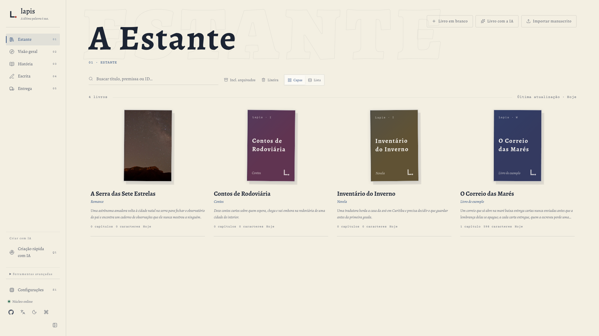
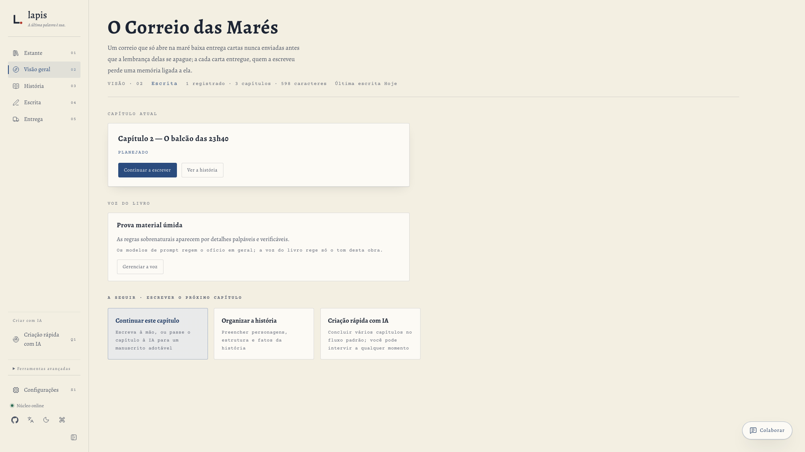
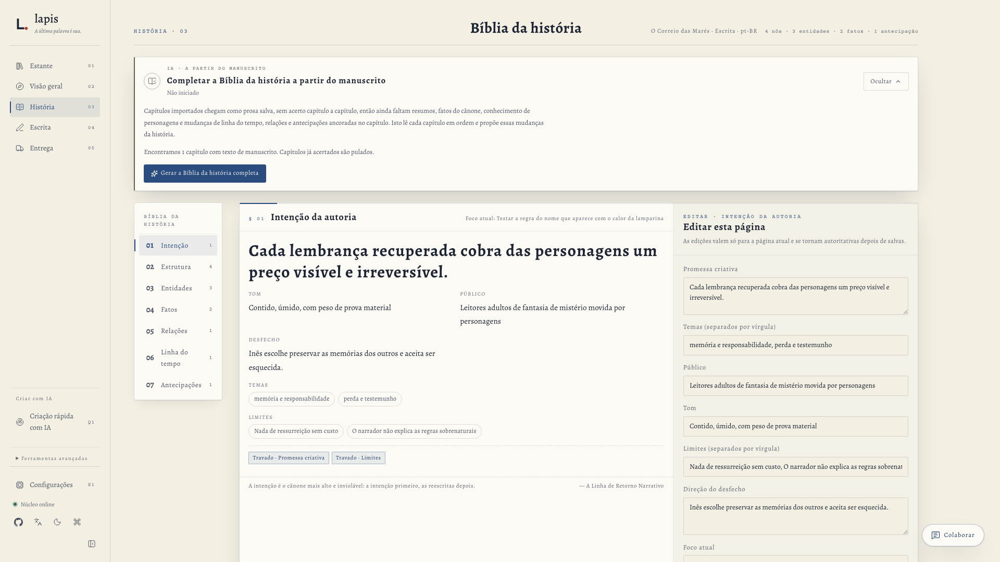
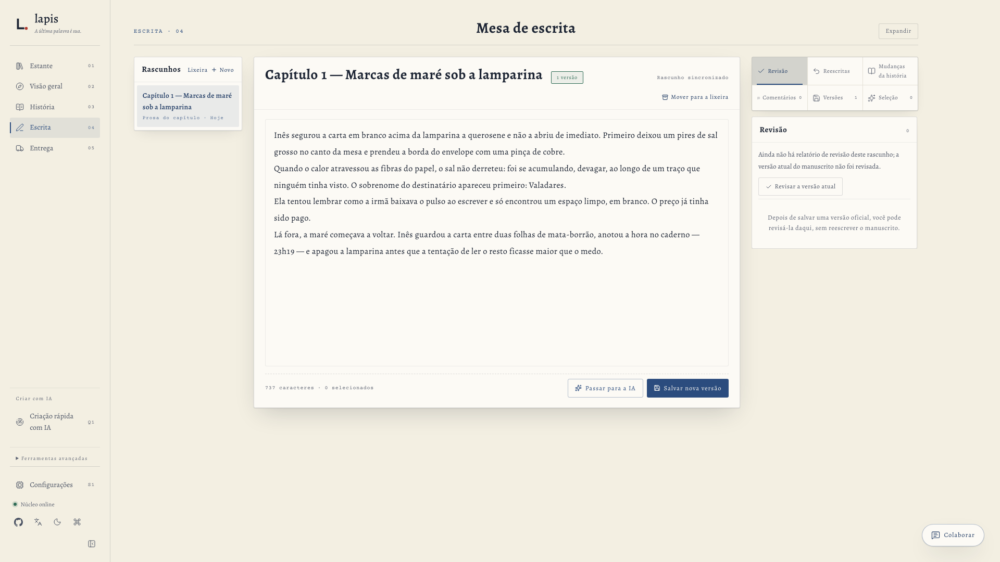
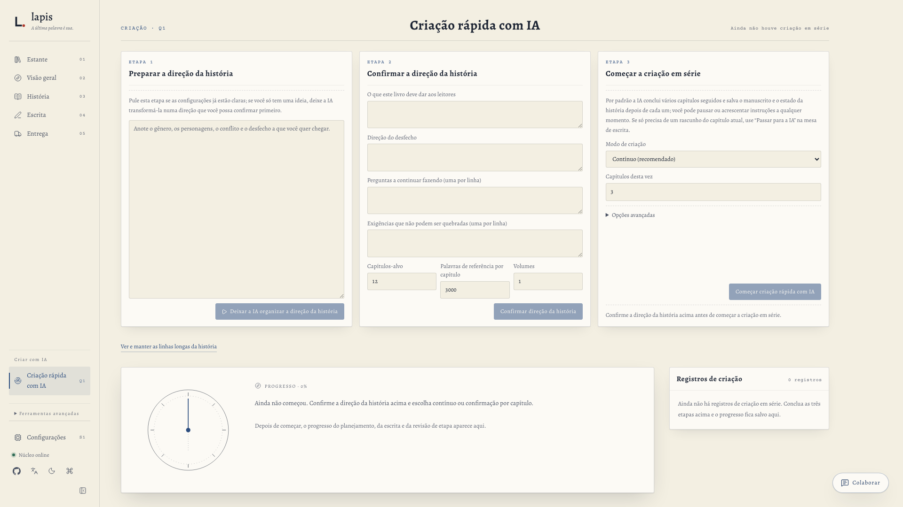
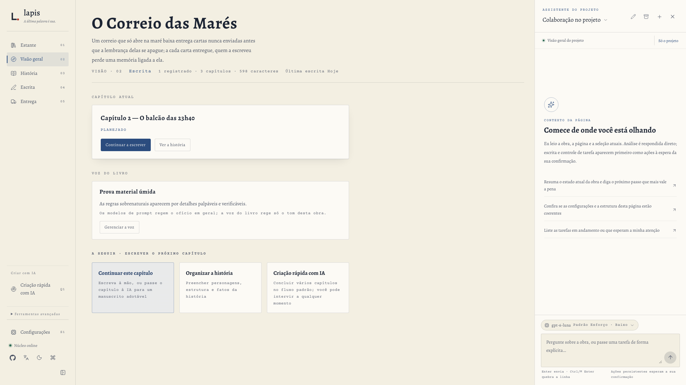
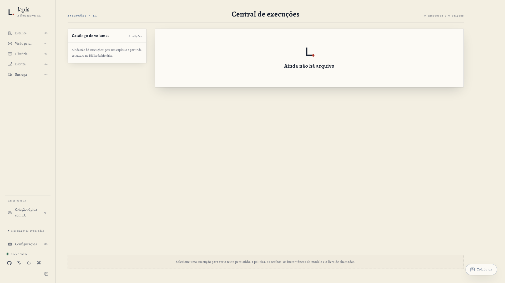
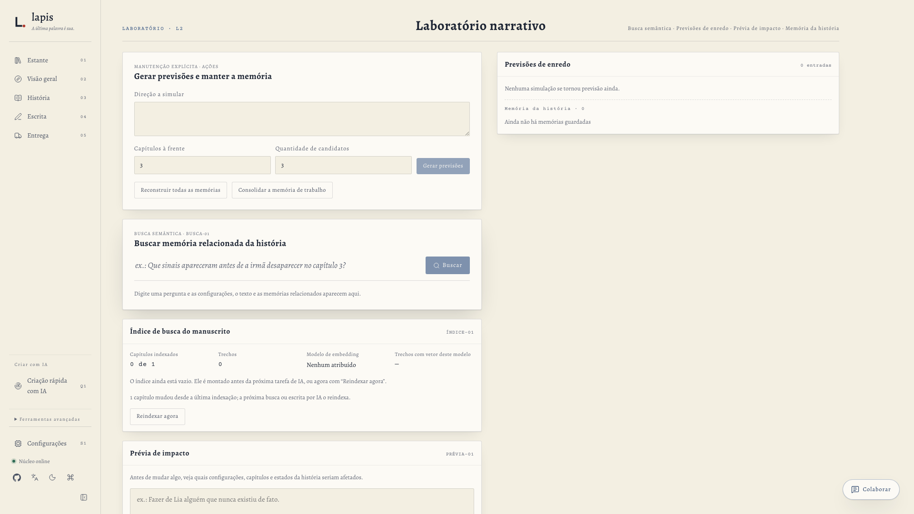
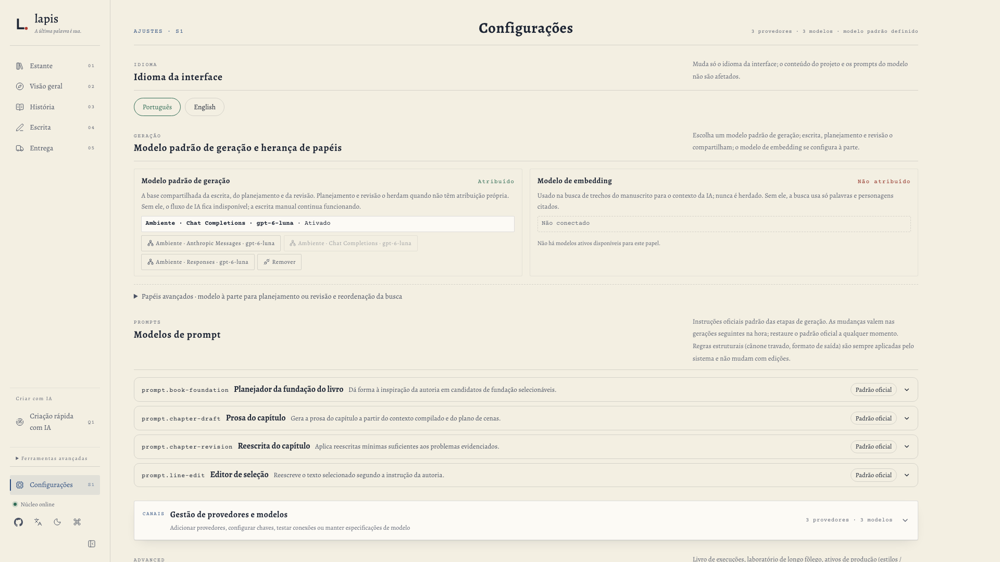
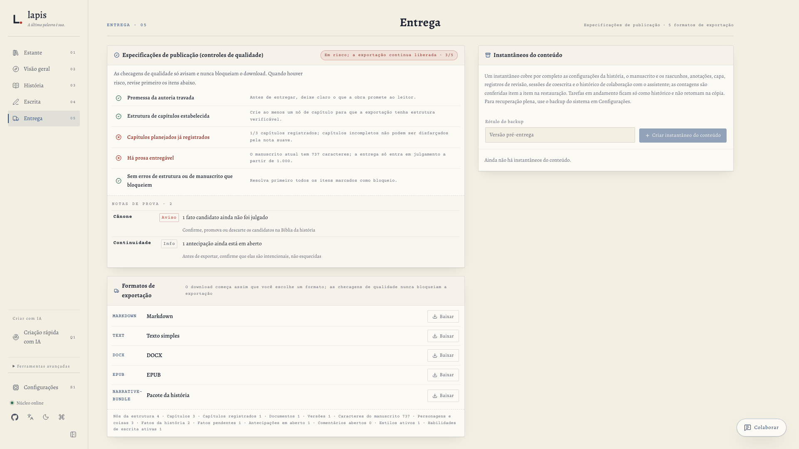

[English](user-guide.en.md)

# Guia do usuário

Este guia apresenta o Lapis na ordem do processo de escrita. Não é preciso lê-lo de ponta a ponta: comece pela Estante e leia cada parte quando chegar a ela. Os nomes de botões da interface aparecem entre aspas.

## Três coisas para saber primeiro

### Escrever não exige modelo

Um modelo só é necessário para geração por IA, revisão, organização da história e busca semântica. Sem modelo, você ainda pode:

- criar, importar e gerenciar obras;
- organizar a intenção da história, a estrutura, os personagens, os fatos, a linha do tempo e as antecipações;
- escrever a prosa à mão na mesa de escrita e salvar versões e comentários;
- exportar obras, criar instantâneos do conteúdo e baixar backups da biblioteca inteira.

### A IA propõe, a autoria decide

Prosa gerada por IA, sugestões de reescrita e mudanças no cânone sempre aparecem primeiro como candidatos. Um candidato nunca sobrescreve a prosa atual nem altera o cânone diretamente. Você pode adotar, recusar ou manter cada item; só o conteúdo adotado vira a versão oficial.

### Onde ficam os dados depende de como você roda

O núcleo local no navegador guarda um banco de dados restrito ao navegador e ao site atuais; os launchers de Windows, macOS e Linux e o modo código-fonte usam o Server local; o Docker usa o próprio volume de dados. Eles não se sincronizam sozinhos só porque usam o mesmo navegador ou o mesmo nome de projeto. Para migrar e recuperar dados, veja [Dados, privacidade e backup](data-and-backup.md).

## Conhecendo a interface

A navegação à esquerda começa pela rotina do dia a dia: Estante, Visão geral, História, Escrita e Entrega. "Criação rápida com IA" fica sozinha no grupo "Criar com IA". Execuções e Laboratório narrativo ficam no grupo "Ferramentas avançadas", que começa recolhido: clique em "Ferramentas avançadas" para abri-lo. Configurações fica no pé da navegação, acima do estado do núcleo. Depois que você entra numa obra, os itens da esquerda sempre apontam para ela — não é preciso voltar à Estante para escolhê-la de novo.

Entradas globais mais usadas:

- Clique no botão de recolher, no canto inferior esquerdo, para dar mais espaço horizontal à prosa; em telas estreitas, a navegação se recolhe sozinha.
- Clique no ícone de sol ou de lua para alternar entre claro e escuro; clique de novo para voltar a seguir o tema do sistema.
- Pressione `Ctrl+K` (`Command+K` no macOS) para abrir a paleta de comandos e ir a um workspace pelo nome.
- Dentro de uma obra, pressione `Ctrl+J` (`Command+J` no macOS) para abrir ou fechar a barra lateral de colaboração do projeto.

"Núcleo online", no canto inferior esquerdo, indica que o driver de dados atual responde às requisições; não garante que algum provedor de modelo esteja utilizável. A conexão com cada modelo é testada à parte, com "Testar" no cartão do modelo em "Configurações".

A interface está disponível em português do Brasil, o idioma principal, e em inglês; um navegador configurado em inglês abre em inglês. Troque o idioma em "Idioma da interface", nas "Configurações", ou pelo botão de idioma no pé da navegação. O idioma da interface não muda o idioma de escrita de uma obra, que é o que decide o idioma da prosa e das respostas da IA. O chinês não é mais oferecido: as obras que, em versões anteriores, tinham o chinês como idioma de escrita passam a usar o português, e o texto delas não é traduzido. Os nomes citados neste guia seguem a interface em português.

## Estante: gerenciar obras

A Estante é a porta de entrada de todas as obras. Cada livro mostra capa, título, subtítulo, premissa, número de capítulos, número de caracteres e a data da última atualização.

A busca procura no título, na premissa e no ID. A barra de ferramentas alterna entre as vistas "Capas" e "Lista"; "Incl. arquivados" só decide se as obras arquivadas aparecem — não muda o estado de nenhuma obra.

### Criar uma obra

Com a Estante vazia, o Lapis pergunta se você tem uma ideia ou um manuscrito: "Só uma ideia" abre o livro com a IA, "Já tenho um manuscrito" abre a importação e "Criar um livro" abre um livro em branco.

Clique em "Livro em branco", preencha o título, escolha o idioma da prosa e a forma (conto, novela ou romance) e clique em "Criar e colocar na estante"; a obra abre na visão geral. A premissa é opcional e pode ser preenchida depois em "Editar livro e capa", na Estante.

Se você só tem uma ideia, clique em "Livro com a IA", escreva a premissa e o que vier — gênero, personagens, rumos — e clique em "Criar e gerar candidatos". A obra abre na hora, enquanto a IA organiza a ideia em candidatos de direção; a visão geral então indica "Confirmar a direção da história". Essa entrada exige um modelo padrão de geração atribuído; sem ele, a obra não é criada.

### Importar um manuscrito

Clique em "Importar manuscrito" e escolha Markdown, texto simples, DOCX, HTML, EPUB ou um pacote de projeto do Lapis (`.json`). O arquivo é dividido em candidatos na hora, sem modelo, e nada é gravado ainda:

1. Na janela de revisão, confira o tipo e o título de cada candidato e desmarque o que não precisar.
2. Clique no botão que coloca os itens marcados na estante, ou em "Agora não" para fechar a janela sem importar.
3. Para importar numa obra que já existe, ou para a IA analisar um manuscrito em personagens, relações, linha do tempo, estilo e candidatos parecidos, use o "Gerenciador de importação" nas Configurações: envie o arquivo, clique em "Analisar com IA", revise os candidatos e aplique os marcados ou clique em "Descartar lote". "Ver execução da análise" abre a análise na Central de execuções.

Um pacote de projeto serve para migrar uma obra já organizada no Lapis; Markdown, texto simples, DOCX, HTML e EPUB servem para importar prosa ou rascunhos antigos. Importações nunca trazem chaves de modelo.

A prosa é dividida em capítulos nos títulos reconhecidos:

- Títulos Markdown de `#` a `###`, linhas chinesas que começam com `第N章` (ou `节`, `卷`, `部` ou `回` no lugar de `章`, com N em numerais chineses ou algarismos e sem espaços) e linhas que começam com `Chapter` seguido de algarismos; essas duas formas de linha não têm limite de tamanho.
- Títulos em português, espanhol ou inglês numa linha só, com até 80 caracteres: `Capítulo`, `Chapter`, `Parte`, `Part`, `Livro`, `Libro` ou `Book` seguido de um número (algarismos, com marca ordinal opcional como em `1º`, `1ª` ou `1.º`; algarismos romanos como `II`; ou números por extenso como `Um`, `Três`, `One`, `Twenty-One`); `Prólogo`, `Prologue`, `Epílogo`, `Epilogue`, `Interlúdio` e `Interlude` podem aparecer sem número. Um título pode vir depois do número após `:`, `.`, `–`, `—`, um `-` seguido de espaço ou um espaço, por exemplo `CAPÍTULO II — O Retorno`, `Capítulo 1- A Chegada` ou `Capítulo 1. A Chegada`. O limite de 80 caracteres vale só para esses títulos com palavra-chave. A linha continua sendo prosa quando a parte do título começa com letra minúscula, como em `Livro 1: leia antes de dormir.`, ou quando a parte do título vem depois de `.` ou de um espaço simples, tem três palavras ou mais e termina num único ponto, como em `Capítulo 3. Era a última página.`. Títulos terminados em `?`, `!`, `…` ou `...`, e títulos depois de `:`, `–`, `—` ou `-`, continuam sendo títulos, por exemplo `Capítulo 5: Quem Matou Laura?` ou `Capítulo 2 — O Fim do Mundo.`. A linha também continua sendo prosa quando o número emenda numa palavra com hífen, como em `Parte segunda-feira para Lisboa.`
- Parágrafos DOCX com os estilos internos de título do Word (Title e Heading 1–3, que no Word em português se chamam `Título` e `Título 1` a `Título 3`) ou com nível de tópico 1–3; `h1` a `h3` em HTML e EPUB. Em HTML e EPUB, um título que só contém uma imagem usa o texto alternativo (alt) da imagem como título, ou `§` quando não há, e uma marcação de título que nunca se fecha, ou que passa de 2000 caracteres, é lida como texto comum.

Um título que só tem a palavra-chave e o número, como `Capítulo 1` ou `Chapter 1`, seguido diretamente de um título com o nome do capítulo, sem texto entre eles (Título 1 + Título 2 no Word, `h1` + `h2` no EPUB), vira um só capítulo chamado `Capítulo 1 — A Chegada`. Isso não vale quando o segundo título também é um título de capítulo (`Parte II` seguido de `Capítulo 1`), nem para títulos chineses.

O texto antes do primeiro título (folha de rosto, epígrafe e afins) vira uma seção própria, chamada `卷首` em manuscritos chineses e em outros manuscritos CJK e, nos demais, com o nome da obra. Uma seção que só contém um número de página (um sumário no começo do livro) é descartada apenas sob títulos com palavra-chave em português, espanhol e inglês escritos como linhas simples, como `Capítulo 1 — A Chegada` ou `Chapter One — Arrival`. Linhas que começam com `Chapter` seguido de algarismos (`Chapter 1 — Arrival`) e títulos chineses mantêm o comportamento anterior, e títulos de Markdown, DOCX, HTML e EPUB também não são filtrados: um sumário sob eles ainda é importado como seções curtas de número de página, que você pode desmarcar antes de aplicar. Uma linha só com `#`, `# # #`, `***`, `* * *` ou `⁂` é uma quebra de cena e fica no texto em qualquer formato, mesmo com estilo ou marcação de título. Quando nenhum título é reconhecido, o texto inteiro é importado como um único manuscrito.

A análise por IA ("Analisar com IA" no Gerenciador de importação) é instruída a escrever os candidatos no idioma do próprio manuscrito. Para manuscritos em português, espanhol, inglês e chinês, o pedido também informa o idioma detectado pelas palavras mais comuns ou pelo sistema de escrita. As duas coisas são feitas na base do melhor esforço, então confira os candidatos antes de aplicá-los. Os rótulos que o próprio Lapis acrescenta, como o título do candidato de intenção da autoria e os cabeçalhos das notas importadas, seguem o idioma do projeto. O candidato de estilo estatístico, calculado sem IA, vem em chinês para manuscritos CJK, em português para manuscritos detectados como português e em inglês para todos os outros, inclusive o espanhol; o candidato de estilo da IA segue o idioma do manuscrito.

### Completar a Bíblia da história a partir do manuscrito

Os capítulos importados chegam como prosa salva, mas ainda não foram acertados capítulo a capítulo, então faltam os resumos de capítulo, os fatos do cânone, o conhecimento dos personagens e as mudanças de linha do tempo, relações e antecipações ancoradas em cada capítulo. "Completar a Bíblia da história a partir do manuscrito" acerta cada capítulo em ordem de leitura, pelo mesmo fluxo de mudanças da história usado quando você salva um capítulo à mão. Usa o modelo de escrita atribuído nas Configurações e se recusa a começar, em vez de pular capítulos, quando não há modelo disponível. Cada capítulo gera custo de modelo: pelo menos uma chamada de modelo, novas tentativas automáticas quando uma resposta falha ou é inválida (até 5 tentativas, e uma resposta malformada pode acrescentar uma chamada de reparo), mais uma chamada de embedding por capítulo quando há um modelo de embedding atribuído. Não há teto de gasto, então use "Pausar" ou "Cancelar conclusão" quando quiser parar; o painel mostra as chamadas de modelo e os tokens usados até agora e, quando os preços dos modelos estão configurados em `NARRATIVE_MODEL_PRICING_JSON`, uma estimativa de custo.

- Onde começar: depois de colocar na estante uma importação com texto de manuscrito, a janela de importação da Estante oferece "Gerar a Bíblia da história com IA"; em Configurações → "Gerenciador de importação", o mesmo link aparece ao lado da mensagem "Importação aplicada." Os dois abrem a Bíblia da história com o painel "Completar a Bíblia da história a partir do manuscrito" aberto no topo. Você também pode abrir esse painel ali a qualquer momento com "Mostrar" e clicar em "Gerar a Bíblia da história completa".
- A janela de início pergunta como as mudanças da história serão adotadas, mostra quantos capítulos com texto de manuscrito serão processados e lembra o custo de modelo. Clique em "Gerar" para começar.
- "Revisar cada capítulo" pausa depois de cada capítulo que produziu mudanças e as mostra no próprio painel. Clique em "Aplicar e continuar" ou "Recusar e continuar"; o capítulo seguinte só é acertado depois dessa decisão, porque os capítulos posteriores se apoiam no cânone que os anteriores estabeleceram. O mesmo conjunto de mudanças também aparece no painel "Mudanças da história" da mesa de escrita. Capítulos sem mudanças da história seguem sozinhos.
- "Gerar tudo automaticamente (recomendado)", o padrão, adota as mudanças de cada capítulo assim que ficam prontas e, fora isso, segue pelo livro inteiro sem supervisão. Quando uma mudança conflita com o cânone atual (mira um registro travado, ausente ou que mudou desde então), a conclusão para e lista os conflitos. Escolha "Forçar aplicação e continuar" (só quando o conflito pode ser sobrescrito), "Aplicar e continuar" depois de corrigir o registro, "Recusar e continuar" ou "Pular capítulo". Ela também para antes que um capítulo retire ou substitua um fato, mude ou encerre uma relação, ancore um evento da linha do tempo no capítulo, ou desenvolva ou resolva uma antecipação que nem esta conclusão nem a importação criaram — por exemplo, qualquer coisa que você mesmo registrou —, e antes que reabra uma antecipação resolvida ou abandonada; o painel lista esses registros para você aplicar ou recusar o capítulo, e a conclusão então continua. As antecipações criadas pela importação registram de onde vieram, então desenvolvê-las ou resolvê-las não faz a conclusão parar; antecipações de uma importação aplicada antes desta atualização não têm origem registrada e contam como suas. Fatos, eventos, relações e antecipações novos são acrescentados sem parar.
- Durante a execução, o painel mostra quantos capítulos já foram concluídos, o capítulo em leitura e um estado para cada capítulo (Aguardando, Lendo, Precisa de revisão, Aplicado, Recusado, Sem mudanças, Falhou, Pulado, Já acertado). Use "Pausar", "Retomar" ou "Cancelar conclusão" a qualquer momento; pausar espera o capítulo atual terminar, exceto quando a conclusão está reaproveitando um acerto que você iniciou na mesa de escrita, que continua rodando. Se o acerto de um capítulo falhar, use "Tentar de novo o capítulo" ou "Pular capítulo"; "Ver execução" abre a execução dele na Central de execuções. O progresso fica salvo, então o trabalho continua de onde parou depois de um reinício. Se a conclusão parar por um erro inesperado, o painel explica o que houve e "Retomar" tenta de novo a partir do mesmo capítulo. Cancelar mantém as mudanças já adotadas; as que ainda aguardam decisão ficam no painel "Mudanças da história", e um acerto que você iniciou na mesa de escrita continua rodando lá. Pular um capítulo que aguarda revisão também não o decide: o conjunto de mudanças dele fica no painel "Mudanças da história".
- Se você editar um capítulo que a conclusão ainda vai ler, ela lê o texto novo uma vez, em vez de abrir um acerto separado; o estado do capítulo registra a edição, e um conjunto de mudanças já produzido para o texto anterior fica sem decisão no painel "Mudanças da história". Se você cancelar antes de a conclusão chegar lá, o capítulo editado é acertado pela mesa de escrita, como de costume. Um acerto que a mesa de escrita já fez para exatamente o texto atual é aproveitado, sem nova leitura.
- Capítulos cujo texto atual já foi acertado, com o resultado aplicado ou sem mudanças da história, são pulados; capítulos cujas mudanças foram recusadas são lidos de novo. Relações, eventos da linha do tempo e antecipações extraídos na importação são referenciados e atualizados, não criados de novo: quando um capítulo mostra um evento da linha do tempo que a importação extraiu e que nenhum capítulo tem ainda, esse evento é ancorado no capítulo (aparece como "Linha do tempo · âncora" nas mudanças da história, mantendo título, descrição, participantes, causas e visibilidade) em vez de ser acrescentado uma segunda vez. Cada capítulo recebe os eventos importados cuja evidência de origem está nele, mais um número limitado dos que não puderam ser situados em nenhum capítulo, para que eventos que a prosa só menciona no começo não tomem o lugar dos capítulos seguintes. Ao terminar, a passagem informa quantos eventos importados da linha do tempo ainda não estão ancorados num capítulo; eles ficam na seção Linha do tempo. Só esta passagem ancora eventos existentes; os acertos comuns de capítulo sempre criam eventos novos. Os resumos de capítulo e as mudanças da história são pedidos no idioma do próprio capítulo (um manuscrito em português recebe resumos em português, por exemplo), na base do melhor esforço.
- Ao terminar, o painel resume quantos capítulos foram aplicados, recusados, ficaram sem mudanças, foram pulados ou falharam. Seções mais amplas, como a intenção da autoria, a estrutura geral e os perfis de personagem, não são escritas a partir de capítulos isolados: os botões de sugestão do painel para "Intenção", "Estrutura" e "Entidades" levam ao painel de candidatos de IA de cada seção. "Rodar de novo" processa os capítulos acrescentados, alterados ou recusados desde então.
- Um clique para a Bíblia da história inteira: o botão "Gerar a Bíblia da história completa" do painel lê todos os capítulos em ordem com "Gerar tudo automaticamente (recomendado)" escolhido por padrão, sem que você precise clicar capítulo a capítulo. Com "Em seguida, gerar sugestões de Intenção, Entidades e Estrutura com IA (você as revisa em cada aba)" marcado (o padrão), o painel inicia as sugestões de IA dessas três seções assim que o último capítulo termina. Se o painel estiver fechado nesse momento, ele as inicia na próxima vez que abrir neste computador, e "Gerar Intenção, Entidades e Estrutura com IA" as inicia à mão a qualquer momento.
- Para refazer um capítulo, abra a lista de capítulos concluídos e clique em "Reler" ao lado dele. A IA lê esse capítulo de novo contra a Bíblia da história atual, acrescenta o que falta e corrige o que está errado, sem duplicar registros existentes; "Revisar as mudanças antes de aplicá-las" vem marcado por padrão. Para refazer uma seção como Entidades, use o painel de IA dessa aba com a sua própria instrução.
- Um projeto cuja prosa foi importada como um único manuscrito não tem capítulos para acertar. O painel avisa; reimporte o arquivo com títulos de capítulo (por exemplo, "Capítulo 1" ou um "# Título do capítulo" em Markdown) para que cada capítulo vire um documento próprio.

### Capas, cópias e arquivamento

No menu de mais ações de uma obra, "Editar livro e capa" edita o título, o subtítulo, a premissa, o idioma da escrita e a capa. As capas aceitam JPG, PNG e WebP e, depois do envio, podem ser ajustadas num enquadramento vertical 3:4.

"Copiar" cria uma obra independente, boa para versões experimentais ou para entregar a quem colabora. "Arquivar" tira a obra da Estante padrão sem apagar conteúdo; ative "Incl. arquivados" para vê-la de novo.

### Lixeira

Só uma obra arquivada pode ir para a lixeira: "Mover para a lixeira" pede que você digite o título e guarda a obra por 30 dias. Obras na lixeira podem ser restauradas e voltam arquivadas; "Excluir em definitivo" não tem volta, e depois disso só um backup feito antes ainda guarda a obra. Confirme que você tem um backup legível antes de excluir.

## Visão geral do projeto: saber o que fazer em seguida

Ao entrar numa obra, você chega à "Visão geral", encabeçada pelo título do livro. Ela reúne:

- os capítulos registrados, o total de caracteres e a data da última escrita;
- a tarefa de IA em andamento;
- pendências como pontos de revisão, propostas de reescrita e mudanças da história;
- entradas para o próximo passo, como "Continuar a tarefa atual", "Organizar a história" e "Criação rápida com IA".

Você pode sair da página enquanto uma tarefa continua em segundo plano. Ao voltar, retome o ponto em que parou pela visão geral ou pelo cartão da tarefa ("Voltar à tarefa") — não envie o mesmo trabalho duas vezes.

## História: manter o material da história

A página "História" também se chama "Bíblia da história". Ela guarda o material que afeta os capítulos seguintes em sete seções — "Intenção", "Estrutura", "Entidades", "Fatos", "Relações", "Linha do tempo" e "Antecipações" —, que você troca rápido pelas abas à esquerda.

### Intenção da autoria

Registre a experiência de leitura central que este livro promete, além de temas, público, tom, direção do desfecho, foco atual e os limites do que ele não vai escrever. É uma referência importante para o planejamento e a revisão da IA, e a sua base para julgar se um rascunho candidato saiu do rumo.

### Estrutura

Monte a hierarquia de volumes, capítulos e cenas, com títulos, resumos e objetivos de capítulo. A aba tem quatro vistas: "Estrutura e edição", "Quadro da história", "Linhas longas da história" e "Estado do capítulo". A prosa de um capítulo pode se vincular a um nó da estrutura; nós já vinculados ou arquivados não reaparecem na lista de novos capítulos.

A estrutura é o plano de escrita, não a prosa. Editar a estrutura não reescreve sozinha os capítulos já salvos.

### Linhas da história e propostas de progresso

Use "História → Estrutura → Linhas longas da história" para manter objetivos de etapa, progresso, promessas em aberto e o rumo futuro. As revisões de etapa da criação contínua produzem propostas de progresso apoiadas em resumos do manuscrito, com os valores de antes e depois, os resumos de evidência usados no momento da revisão e links de volta aos capítulos.

Só a aceitação item a item atualiza uma linha da história; recusar registra a decisão sem mudar o registro. Propostas desatualizadas não podem sobrescrever registros que mudaram, e repetir uma decisão não aplica a mudança duas vezes. A janela de planejamento seguinte leva em conta as decisões da autoria; o rumo futuro continua sendo um plano. Resumos do manuscrito ausentes ou desatualizados nunca são substituídos por resumos da estrutura como evidência.

### Conferir e manter o conhecimento por capítulo

Em "História → Estrutura → Estado do capítulo", escolha um capítulo e uma perspectiva para inspecionar os registros até o fim daquele capítulo, incluindo as cenas dele. Um fato que mudou não quer dizer que um personagem soube dele. Crenças, suspeitas e crenças falsas aparecem separadas; a falta de registro não quer dizer desconhecimento.

Abra "Registrar e corrigir conhecimento" para a manutenção pela autoria. Ali estão os registros e o histórico de correções do livro inteiro, independente do filtro de perspectiva. Escolha o leitor ou um personagem, um fato ou evento existente, um estado de crença e um capítulo ou cena registrado. Registros com data retroativa preservam as mudanças de conhecimento posteriores.

Use "Registrar mudança de conhecimento" quando uma crença muda mais adiante na história. Use "Corrigir registro" para consertar um estado de crença ou um nó de evidência errado, com um motivo. Se quem sabe ou o que se sabe está errado, use "Retirar registro" e registre de novo. As entradas originais e os motivos ficam no histórico. Uma retirada pode trazer de volta uma entrada válida anterior; ela não representa um esquecimento na história.

Se registros ou referências relacionados mudarem antes de salvar, o que você digitou é preservado, com um aviso de conflito. Copie o que quiser manter, escolha "Descartar alterações e recarregar", revise e envie de novo. Os registros salvos informam a inspeção e a geração seguinte, sem reescrever a prosa existente.

### Entidades, fatos do cânone e relações

- "Entidades" guarda pessoas, lugares, organizações, objetos e afins.
- "Fatos do cânone" guarda conteúdo confirmado, como estados de personagens, habilidades e limites do cenário.
- "Relações" registra como as relações entre pessoas ou entidades mudam, e quando.

Você pode editá-los à mão em "Editar esta página" ou gerar candidatos de IA na seção correspondente. O painel de candidatos mostra as diferenças item a item; mudar conteúdo travado pede uma confirmação explícita ("Confirmar mudança de conteúdo travado"), então um candidato comum nunca o sobrescreve em silêncio.

### Linha do tempo e antecipações

A linha do tempo registra eventos do mundo da história, com datas e observações. As antecipações acompanham pistas planejadas, plantadas, em desenvolvimento, resolvidas ou abandonadas. Uma antecipação não resolvida não é um erro por si só; o estado dela só muda quando você decide.

### Candidatos da história

Em "Mudanças candidatas", escreva o que quer acrescentar ou ajustar — por exemplo, "deixar a motivação do personagem mais concreta, sem mudar o final travado". Depois de "Gerar mudanças candidatas", revise as diferenças item a item e escolha "Adotar este item" ou "Recusar". Nada entra no material da história antes da adoção.

## Escrita: do rascunho à versão oficial

### Criar um manuscrito

Na página "Escrita", clique em "Novo" e escolha o "Tipo":

- "Prosa do capítulo": vinculada a um capítulo da estrutura;
- "Prosa da cena": vinculada a uma cena da estrutura; pode usar a reescrita da seleção com IA, mas "Passar para a IA" só aparece para prosa de capítulo;
- "Rascunho da estrutura", "Sinopse", "Notas de escrita" e "Amostra de estilo": material de apoio.

A prosa de capítulo e a de cena precisam estar vinculadas a um nó da estrutura; nós já vinculados a um manuscrito ou arquivados não são oferecidos de novo. Se não houver estrutura correspondente, volte a "História" e crie primeiro o capítulo ou a cena.

### Escrever à mão e salvar versões

O editor de prosa é um editor de texto formatado que guarda o texto em Markdown. Digite ou cole o texto direto; o rascunho é sincronizado enquanto você escreve. Quando terminar, clique em "Salvar nova versão". Uma versão salva guarda a prosa atual e o momento em que foi salva; depois você pode revê-la no painel "Versões" e restaurar uma versão anterior.

Restaurar nunca reescreve versões antigas: "Restaurar como nova versão" acrescenta o conteúdo escolhido como uma versão nova, que passa a ser a atual.

### Lixeira de manuscritos

"Mover para a lixeira", no alto da mesa de escrita, ao lado do título do manuscrito, esconde o manuscrito atual e mantém a prosa, as versões, os comentários e os registros de revisão. Manuscritos na lixeira não entram em novas tarefas de escrita, revisão ou exportação; para voltar a usar um deles, abra "Lixeira" no alto da lista de rascunhos e clique em "Restaurar para os rascunhos".

A lixeira de manuscritos e a lixeira da Estante não estão no mesmo nível. A primeira cuida dos manuscritos de uma obra e os guarda até você restaurá-los, sem prazo; a segunda cuida de obras inteiras. Restaurar um manuscrito não muda o estado de arquivamento da obra.

### Seleções, comentários e edições locais

Primeiro selecione um trecho da prosa e depois abra a ferramenta "Seleção":

- Registre em "Comentário" o que vale a pena rever. Se o texto tiver mudanças que ainda não viraram versão, o botão fica "Salvar versão e comentar" e salva uma versão antes, para o comentário ficar ancorado nela.
- Descreva o objetivo em "Instrução de reescrita da IA" — por exemplo, "reduzir a descrição repetitiva das ações, mantendo a tensão" — e clique em "Gerar proposta de reescrita". A proposta aparece logo abaixo, em "Reescritas da seleção", com o original riscado e o novo trecho inserido.
- "Aceitar" aplica a proposta como uma versão nova, e "Recusar" a descarta; para tentar outra instrução, gere uma nova proposta. Uma proposta nunca substitui a prosa sem a sua decisão.

### Passar um capítulo para a IA

Com uma prosa de capítulo aberta, clique em "Passar para a IA". A IA gera um capítulo candidato a partir do material da história e da estrutura atuais e depois roda verificações automáticas e uma revisão. O painel da tarefa abre no alto da mesa de escrita com o "Plano do capítulo", o "Manuscrito candidato" e "Esta revisão".

"Adotar como versão do manuscrito" cria uma versão oficial da prosa; em seguida, as mudanças da história do capítulo esperam por você no painel "Mudanças da história". "Pedir outra passagem" manda à IA uma instrução de reescrita, e "Descartar candidato" descarta o candidato. Se a geração falhar, corrija primeiro o modelo ou a rede e depois clique em "Tentar de novo este capítulo". Se a geração for interrompida, o trecho já gerado pode ser recuperado em "Ver os detalhes da tarefa", na Central de execuções.

### Revisão e reescritas

O painel "Revisão" mostra o veredito da versão atual, o detalhamento das notas e os pontos que aguardam decisão; numa prosa de capítulo, "Revisar a versão atual" ou "Revisar de novo" pede uma nova revisão. Os pontos costumam ser classificados como continuidade, personagem, ritmo, prosa, objetivo do capítulo e afins.

Cada ponto traz trechos de evidência e uma sugestão de ação. Você pode clicar em "Aceitar" ou "Recusar", marcar como "Falso positivo" ou "Manter de propósito". As reescritas do texto inteiro propostas pela IA aparecem na aba "Reescritas" ("Propostas de reescrita"): "Aplicar como nova versão" transforma uma delas na versão atual, e "Recusar" a descarta.

A revisão é uma checagem auxiliar, não uma licença de publicação. Se um trecho fica ou não é sempre decisão da autoria.

### Mudanças da história

Depois de salvar uma versão de capítulo ou adotar um candidato da IA, o sistema organiza os estados de personagens, fatos, relações, eventos da linha do tempo e antecipações que esse capítulo pode ter mudado. As mudanças aparecem no painel "Mudanças da história" e só entram no material da história com "Adotar estas mudanças"; "Agora não" as recusa.

Se uma mudança conflitar com o cânone atual — por exemplo, com um registro travado —, o painel lista os conflitos em vez de adotar. Quando eles podem ser sobrescritos, aparece "Forçar adoção"; caso contrário, recuse o conjunto e corrija a origem no manuscrito. Resolva o conflito primeiro e depois siga com as próximas tarefas.

A cocriação não faz parte da v1, e a mesa de escrita não leva mais a ela.

## Criação rápida com IA: vários capítulos numa só execução

"Criação rápida com IA" serve quando o rumo já está claro e você quer avançar vários capítulos de uma vez. Ela usa o mesmo fluxo de produção de capítulos de "Passar para a IA", numa escala maior.

### Três passos

1. **Preparar a direção da história** (opcional): escreva a ideia e clique em "Deixar a IA organizar a direção da história"; depois escolha "Adotar" ou "Deixar de lado" em cada candidato. Pule este passo se o rumo já estiver claro.
2. **Confirmar a direção da história**: preencha o que o livro deve dar aos leitores, a direção do desfecho, as perguntas a continuar fazendo, as exigências que não podem ser quebradas, os capítulos-alvo, as palavras de referência por capítulo e o número de volumes; depois clique em "Confirmar direção da história".
3. **Começar a criação em série**: escolha o "Modo de criação" — "Contínuo (recomendado)" ou "Esperar a minha confirmação depois de cada capítulo" — e quantos capítulos escrever desta vez. Em "Opções avançadas" ficam o planejamento dos capítulos, quantos capítulos planejar à frente, o máximo de reescritas automáticas e a qualidade da geração. Clique em "Começar criação rápida com IA".

Em "Planejamento dos capítulos", "Rodar automaticamente" (o padrão) deixa a tarefa planejar cada capítulo sozinha; escolha "Confirmar primeiro o plano de cada capítulo" para ver e adotar cada plano antes. Quando um plano propõe personagens, lugares ou outros elementos novos, a tarefa para em "Novos elementos da história no plano": os capítulos só são criados depois das suas decisões.

### Como intervir durante a execução

A página mostra o capítulo atual, as etapas, o motivo de qualquer parada e as ações disponíveis. Durante a execução, você pode dar direção em "Instruções criativas para a IA" ("Aplicar aos próximos capítulos"), "Pausar", "Retomar" ou "Encerrar esta criação"; depois de uma interrupção, pode tentar de novo o capítulo atual, pulá-lo, replanejar ou parar.

- Uma exigência sobre o capítulo atual vira uma nota ativa e interrompe o capítulo em andamento; exigências sobre as próximas cenas viram notas ativas, e exigências sobre capítulos futuros disparam um novo planejamento.
- Exigências que mudam o cânone ou reescrevem prosa existente esperam em "Instruções aguardando decisão": "Adotar e reagendar" ou "Recusar e continuar escrevendo".
- Depois que um candidato é adotado, os capítulos seguintes continuam a partir do novo estado.
- Quando a tarefa encontra um conflito com um fato travado ou um problema crítico de revisão, ela para e espera você resolver.

## Assistente do projeto: achar o caminho numa frase

Dentro de um projeto, clique em "Colaborar", no canto inferior direito, para fazer perguntas ao assistente ou descrever um objetivo. Por padrão, o assistente lê o contexto da página atual — o capítulo escolhido, a seleção na prosa ou uma seção da história; "Só o projeto", na faixa de contexto, faz as próximas mensagens usarem só o material global do projeto, e "Seguir a página" volta atrás. `Ctrl+J` ou `Command+J` também abre e fecha a barra lateral.

Coisas que funcionam bem ditas diretamente:

- "Mostre os pontos de revisão sem solução deste capítulo."
- "Planeje três conflitos possíveis para o próximo capítulo."
- "Deixe este trecho mais contido; me dê candidatos primeiro."
- "Pause a criação rápida atual e mantenha os capítulos prontos."

Cada projeto pode ter várias conversas de colaboração. O menu no topo troca de conversa, e os botões ao lado renomeiam, arquivam e criam conversas; uma conversa arquivada é só leitura, mas o histórico, a atividade das tarefas e os artefatos principais continuam lá. No pé da barra lateral, você troca o "Modelo" e o "Esforço" da conversa atual, dentro do mesmo protocolo; para usar outro protocolo, mude o modelo padrão de geração em "Configurações".

O assistente responde direto a perguntas de análise; quando o assunto é escrita ou controle de tarefas, ele propõe primeiro as ações pendentes, que você executa com "Confirmar e executar" ou descarta com "Não executar". A adoção de prosa, a adoção de mudanças no cânone e a exclusão definitiva continuam sendo feitas nas próprias páginas, para evitar enganos dentro de um chat.

### Habilidade de escrita e Agent Skill

As duas ficam em "Configurações" → "Ferramentas avançadas", para o projeto escolhido em "Projeto dos ativos de produção".

- Uma habilidade de escrita (Writing Skill) é um pacote de prompts de escrita e material de referência, ativado por escopo: `all`, `chapter`, `edit` ou `review` (a lista ainda mostra `cocreate`, mas a cocriação não faz parte da v1). Você pode criá-las e editá-las na aba "Habilidade de escrita", ou importar ("Importar .skill.zip"), validar ("Validar") e exportar ("Exportar pacote") pacotes `.skill.zip`.
- Uma Agent Skill é um pacote restrito de tarefas do assistente que declara a descrição de quando acionar, as instruções e uma lista de capacidades permitidas. Por enquanto ela é importada de um pacote ZIP ("Importar pacote de Agent Skill"); pode ser ativada, desativada ou excluída, mas não criada nem exportada pela interface.

Uma Agent Skill importada só usa as capacidades somente leitura ou de candidato que o sistema permite; não roda scripts arbitrários, não faz requisições de rede arbitrárias nem grava direto no banco de dados. A adoção de prosa oficial e de cânone confirmado continua seguindo os limites de confirmação embutidos no produto.

## Ferramentas avançadas

### Central de execuções

A Central de execuções organiza cada tarefa de IA por mês, com o estado, os ciclos de reescrita e o número de chamadas de modelo. Ao abrir uma execução, você vê os fluxos de texto, os passos e erros, os checkpoints, as revisões, a política de execução vigente, os recibos de contexto, os instantâneos do modelo e o livro de chamadas.

A página só mostra as operações que o estado atual permite — pausar, retomar, adotar o plano, adotar ou descartar o manuscrito, pedir reescrita, tentar o capítulo de novo, passar para o manual e cancelar. Quando uma geração em streaming é interrompida, a prosa parcial já persistida com pelo menos 50 caracteres pode ser continuada ("Continuar"), aproveitada ("Aproveitar o rascunho parcial"), gerada de novo ("Gerar de novo") ou descartada ("Descartar"); uma prosa parcial menor só pode ser gerada de novo ou descartada. Não comece uma execução idêntica só para recuperar uma tarefa.

Quando uma criação comum falhar, prefira resolvê-la na mesa de escrita ou no cartão da tarefa de criação rápida; entre na Central de execuções quando precisar conferir o motivo da falha, o uso do modelo ou a prosa parcial.

### Laboratório narrativo

O Laboratório narrativo oferece estes tipos de operação: buscar na memória da história em linguagem natural; gerar previsões de enredo por direção, capítulos à frente e quantidade de candidatos; reconstruir ou consolidar a memória; ensaiar em "Prévia de impacto" que material da história uma mudança afetaria antes de fazê-la de verdade; e acompanhar o "Índice de busca do manuscrito", que "Reindexar agora" atualiza. Como a busca, os embeddings e a reordenação funcionam está descrito em [Configuração](configuration.md#busca-semântica-e-embeddings).

As previsões podem ser adotadas ("Adotar") como referência futura ou dispensadas ("Dispensar"); quando o material da história em que se basearam muda, as previsões antigas ficam marcadas como "Desatualizada" e não podem mais ser adotadas. A manutenção da memória e a prévia de impacto são ferramentas de análise — nunca reescrevem sozinhas a prosa, o cânone confirmado ou a linha do tempo.

### Configurações

As Configurações têm estas seções:

- **Idioma da interface**: português ou inglês.
- **Modelo padrão de geração e herança de papéis**: escolha o modelo padrão de geração e o modelo de embedding; os papéis avançados substituem os modelos de planejamento e de revisão e acrescentam a reordenação opcional da busca. A busca, os embeddings e a reordenação estão descritos em [Configuração](configuration.md#busca-semântica-e-embeddings).
- **Modelos de prompt**: edite as instruções oficiais das etapas de geração, em português e em inglês, e restaure o padrão oficial quando quiser.
- **Gestão de provedores e modelos**: crie, edite, desative e teste provedores e modelos.
- **Ferramentas avançadas**: links para a Central de execuções e o Laboratório narrativo, e os ativos de produção do projeto escolhido em "Projeto dos ativos de produção": "Estilos", "Habilidade de escrita", "Agent Skill" e "Gerenciador de importação". Os estilos registram regras positivas, regras proibidas e exemplos; o gerenciador de importação envia arquivos ao projeto, roda a análise por IA e aplica ou descarta lotes de importação.
- **Driver de execução**: alterne entre a detecção automática, o núcleo local no navegador e o serviço local. No modo navegador, a seção mostra também o uso de armazenamento, a autorização de armazenamento persistente e a última exportação da biblioteca.
- **Arquivos de backup do sistema**: crie backups SQLite completos do Server local, confira hash, integridade e chaves estrangeiras e restaure num diretório novo, diferente do diretório de dados atual.

O núcleo no navegador usa "Baixar minha biblioteca (.sqlite)" para obter o arquivo SQLite completo; o Server local usa os arquivos de backup do sistema ou os scripts de backup. Trocar o driver de execução não migra dados; ver outra biblioteca depois de recarregar a página é normal.

## Entrega: exportar e guardar

### Checagens de qualidade

Em "Especificações de publicação (controles de qualidade)", a página Entrega confere a premissa e a promessa ao leitor, o plano de capítulos, se há prosa, manuscritos em branco, fatos candidatos não julgados, antecipações e comentários em aberto e condições parecidas. As checagens de qualidade só avisam; nunca bloqueiam a exportação e não decidem pela autoria se o conteúdo está pronto.

### Formatos de exportação

- Markdown: bom para continuar editando e para controle de versão;
- Texto simples: bom quando só o conteúdo da prosa importa;
- DOCX: bom para entregar a quem usa o Word e vai continuar a diagramação;
- EPUB: bom para pré-visualizar como e-book;
- Pacote da história: o material de uma obra visível à autoria, bom para migrar para outro ambiente do Lapis.

### Instantâneos do conteúdo do projeto

Em "Entrega", preencha o "Rótulo do backup" e clique em "Criar instantâneo do conteúdo". O instantâneo guarda o material da obra, a estrutura da história, as versões da prosa, os comentários, as revisões e o histórico do assistente (e os registros de cocriação, se a obra tiver algum) — mas nenhuma chave de modelo. "Restaurar cópia do conteúdo" cria um projeto novo, sem sobrescrever o original.

Depois de restaurar, confira a estrutura, as versões mais recentes da prosa, os comentários, as mudanças da história e os registros de execução antes de decidir continuar escrevendo.

### Backups da biblioteca inteira

No modo navegador, use "Baixar minha biblioteca (.sqlite)" nas Configurações; com o Server local, use `scripts/backup.ps1` no Windows ou `scripts/backup.sh` no macOS/Linux; com o Docker, use `scripts/docker-backup.ps1`. Um backup SQLite completo pode conter credenciais de provedores, então guarde-o num diretório controlado, como o próprio manuscrito. Nunca copie o arquivo do banco principal diretamente com o serviço rodando.

## Celular e computador

Em telas estreitas, como as de celular, a navegação vira uma barra no pé da tela com os cinco workspaces do dia a dia, e o estado do núcleo e os botões de idioma, tema e paleta de comandos vão para o topo; abra a Criação rápida com IA, as Execuções, o Laboratório narrativo e as Configurações pela paleta de comandos. Navegar, revisar o material da história, tratar candidatos e fazer edições leves funcionam bem no celular; editar prosa longa, criar em série e fazer importações grandes fica melhor num navegador de computador.

## Documentos relacionados

- [Início rápido](quick-start.md): como iniciar os pacotes de release para Windows, macOS e Linux e o ambiente de desenvolvimento.
- [Configuração](configuration.md): protocolos de provedores, variáveis de ambiente, Docker, busca semântica, embeddings e reordenação.
- [Dados, privacidade e backup](data-and-backup.md): onde os dados ficam, instantâneos do conteúdo, pacotes da história e recuperação da biblioteca inteira.
- [Docker Compose](docker.md): auto-hospedagem — rodar, atualizar, parar e fazer backup.
